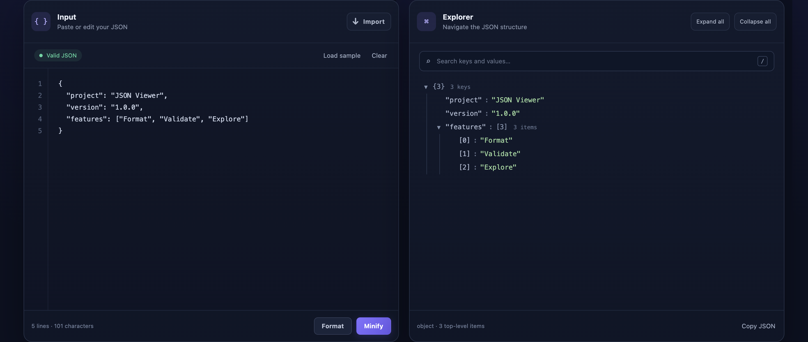
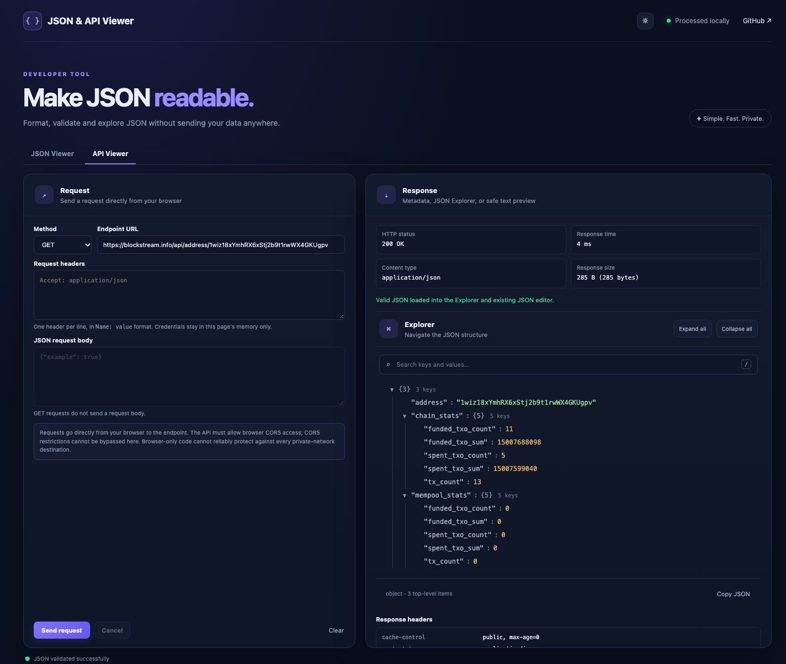
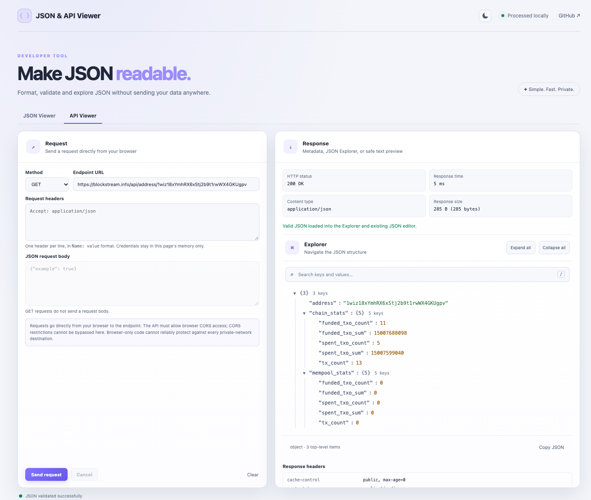

# JSON & API Viewer
A lightweight, browser-based JSON and API viewer. Explore, format, and validate JSON; send API requests and inspect responses; and convert Unix timestamps. Built with vanilla HTML, CSS, and JavaScript, with no runtime dependencies or backend.

**Try it online:** [cryptoumit.github.io/json-viewer](https://cryptoumit.github.io/json-viewer/) or install locally

## Local Installation

Download the project as a ZIP from [GitHub](https://github.com/cryptoumit/json-viewer) and extract it. Open `index.html` in your browser to start using JSON & API Viewer.

## Development checks

The CI workflow checks JavaScript syntax, validates the HTML, and runs browser smoke tests. To run the checks locally, install the development tools and Chromium, then run:

```sh
npm install
npx playwright install chromium
npm run lint
npm run check:js
npm run check:html
npm run test:browser
```

The browser tests use Python 3 to serve the static app locally.

## API Viewer

The API Viewer sends requests directly from your browser and supports GET, POST, PUT, PATCH, and DELETE, with custom headers and an optional JSON body. It shows response status, timing, content type, size, and accessible headers. Valid JSON appears in the API tab's Explorer tree and also populates the existing editor; other response content is shown as text and is never executed.

No API response is sent through a proxy or stored by the app. Requests require the target API to allow browser cross-origin access (CORS), so some APIs will not work. Browser code cannot bypass CORS. For local use, open the project in VS Code and start `index.html` with the Live Server extension; the API must still allow requests from that origin.

## Screenshot

### JSON Viewer

<table>
  <tr>
    <td></td>
    <td></td>
  </tr>
</table>

### API Viewer

<table>
  <tr>
    <td></td>
    <td></td>
  </tr>
</table>

## Keyboard shortcuts

| Action | macOS | Windows/Linux |
| --- | --- | --- |
| Focus tree search | `⌘F` or `/` | `Ctrl+F` or `/` |
| Clear tree search and return to the editor | `Esc` (while search is focused) | `Esc` (while search is focused) |
| Format JSON | `⌥⇧F` or `⌘Enter` | `Alt+Shift+F` or `Ctrl+Enter` |
| Minify JSON | `⌥⇧J` | `Alt+Shift+J` |

The `/` shortcut focuses search when you are not typing in an input or text area.
