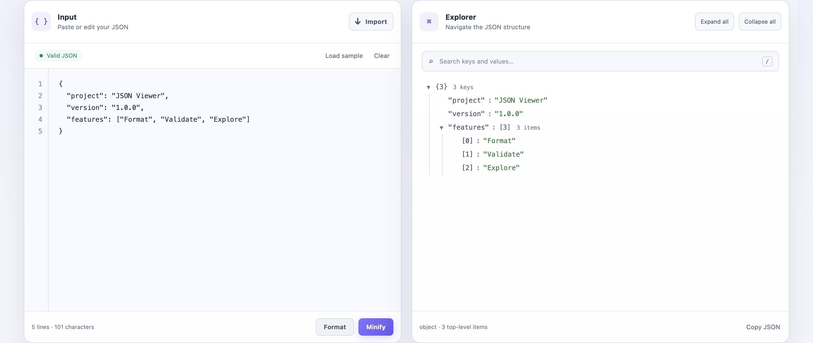

# json-tree-viewer
A lightweight, browser-based JSON viewer with validation, formatting, minification, search, interactive tree navigation, a Unix timestamp converter, and light/dark modes. The converter detects seconds or milliseconds, displays the corresponding UTC date, and converts local date and time values back to timestamps. Built with vanilla HTML, CSS, and JavaScript. No dependencies, no backend, and your data stays private.

## Installation

Download the project as a ZIP from [GitHub](https://github.com/cryptoumit/json-viewer) and extract it. Open `index.html` in your browser to start using JSON Viewer.

## Screenshot

## Keyboard shortcuts

| Action | macOS | Windows/Linux |
| --- | --- | --- |
| Focus tree search | `⌘F` or `/` | `Ctrl+F` or `/` |
| Clear tree search and return to the editor | `Esc` (while search is focused) | `Esc` (while search is focused) |
| Format JSON | `⌥⇧F` or `⌘Enter` | `Alt+Shift+F` or `Ctrl+Enter` |
| Minify JSON | `⌥⇧J` | `Alt+Shift+J` |

The `/` shortcut focuses search when you are not typing in an input or text area.
